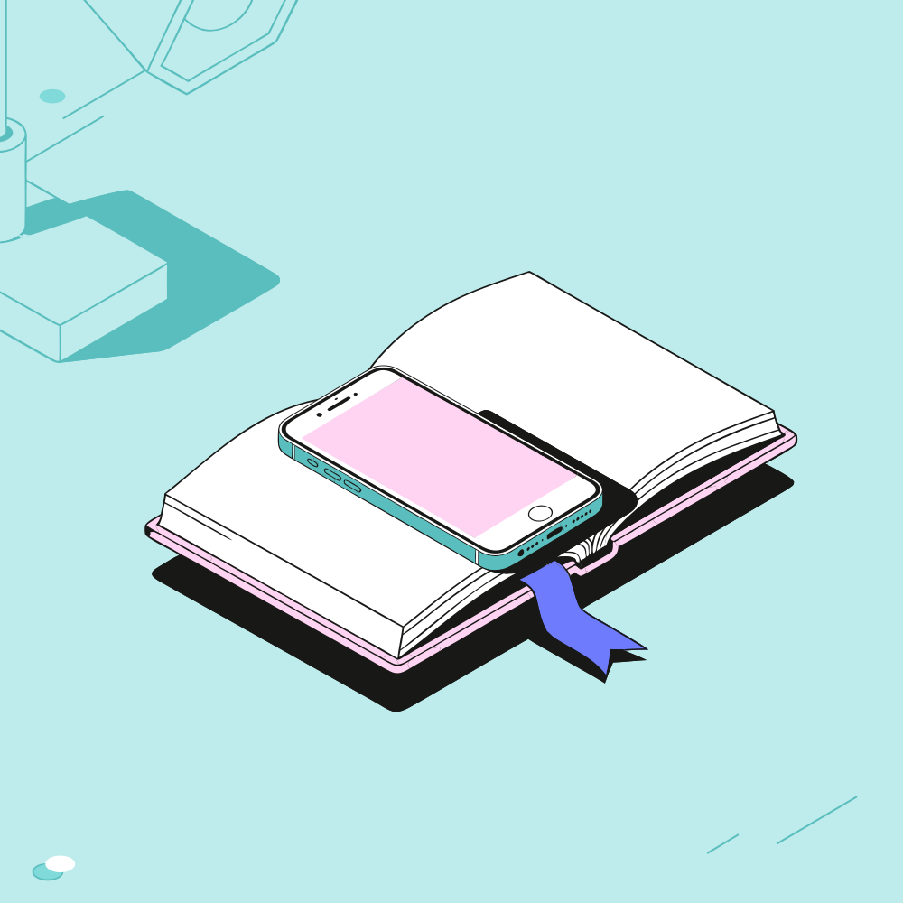
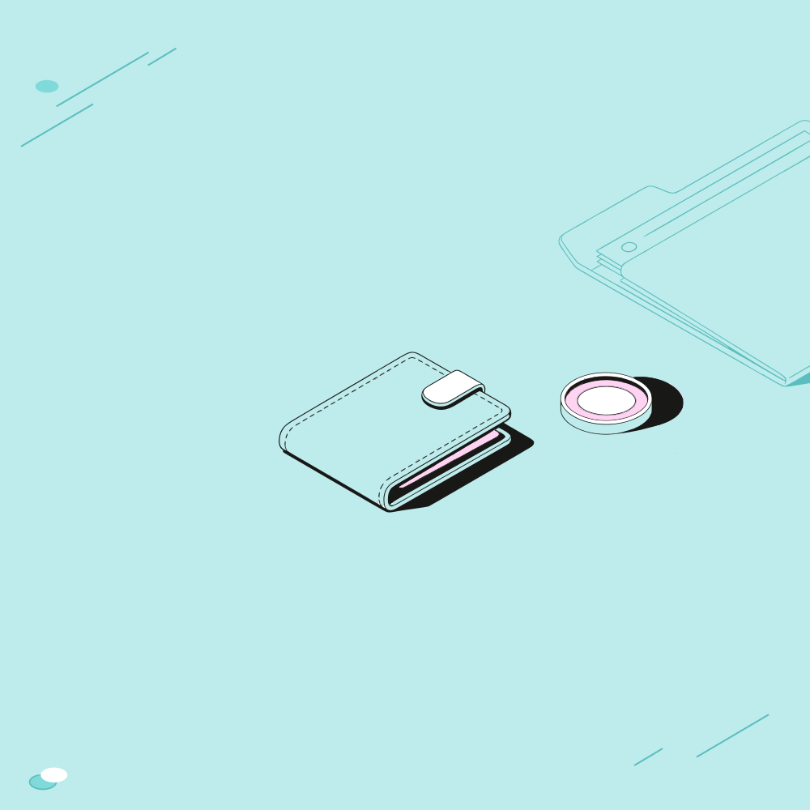

# Конструктор векторных композиций

Отчёт к тестовому заданию. Состояние на 4 ноября 2026 года.

Сервис собирает редактируемые SVG из готовой библиотеки. Пользователь задаёт метафору, заголовок или названия предметов; Gemini выбирает смысловую группу и составляет план размещения. Движок исполняет этот план с проверкой опор и пересечений. Новые иллюстративные объекты не генерируются.

Проверочный набор: **18 метафор, 162 SVG, три формата и три варианта в каждом**. В этом наборе использованы исходные ассеты S в масштабе 1:1. L проверен отдельно; архив из 162 иллюстраций не является полным прогоном L.

- [Галерея всех композиций](../exports/metaphors-2026-11-04/index.html) — интерактивный просмотр при открытии HTML или размещении на сайте.
- [Архив SVG и редактируемых проектов](../exports/metaphors-2026-11-04/compositions.zip).
- [Данные прогона](../exports/metaphors-2026-11-04/manifest.json) и [замечания по результатам](../exports/metaphors-2026-11-04/reviews.json).
- [Исходный текст задания](assignment-original.txt) и [правила библиотеки](library-rules-original.txt).

## Три примера для демонстрации

Эти примеры показывают запись мысли, переход между бумажным и цифровым носителем и финансовую тему. Ниже приведён первый вариант; у каждого примера доступны ещё два расположения во всех трёх форматах.

### Поймать мысль

Главные предметы: Открытая книга, Ручка. Фоновый компаньон: Настольная лампа.

Главная смысловая пара — открытая книга и пишущая ручка, символизирующие фиксацию идей.

Настольная лампа в роли фонового компаньона поддерживает творческую атмосферу рабочего места.

Компактная компоновка объединяет элементы в цельную и выразительную композицию.

[Редактируемый проект](../exports/metaphors-2026-11-04/projects/02.json).

| Формат | Первый вариант |
| --- | --- |
| Квадрат 1000 × 1000 | [Открыть SVG](../exports/metaphors-2026-11-04/svg/02-square-v1.svg) |
| Горизонт 1200 × 630 | [Открыть SVG](../exports/metaphors-2026-11-04/svg/02-landscape-v1.svg) |
| Вертикаль 800 × 1200 | [Открыть SVG](../exports/metaphors-2026-11-04/svg/02-portrait-v1.svg) |

Замечание по результату: Книга и ручка логично связаны; варианты на странице и рядом различаются. Фоновая лампа в квадрате и вертикали разрезана границей кадра на отдельные фрагменты — узнаваемость снижена.

### От бумажного к цифровому

Главные предметы: Открытая книга, Смартфон. Фоновый компаньон: Настольная лампа.

Главная пара книги и смартфона раскрывает переход от традиционного чтения к цифровым технологиям.

Настольная лампа в роли фонового компаньона добавляет глубину и мягко освещает сцену.

Компактное расположение сохраняет читаемость силуэтов и цельность композиции.

[Редактируемый проект](../exports/metaphors-2026-11-04/projects/08.json).

| Формат | Первый вариант |
| --- | --- |
| Квадрат 1000 × 1000 | [Открыть SVG](../exports/metaphors-2026-11-04/svg/08-square-v1.svg) |
| Горизонт 1200 × 630 | [Открыть SVG](../exports/metaphors-2026-11-04/svg/08-landscape-v1.svg) |
| Вертикаль 800 × 1200 | [Открыть SVG](../exports/metaphors-2026-11-04/svg/08-portrait-v1.svg) |

Замечание по результату: Книга и телефон хорошо выражают переход от бумаги к цифровому. Есть варианты на книге и отдельно; источник SVG не меняется. Фоновая лампа повторяет соседние сюжеты.

### Держать финансы под контролем

Главные предметы: Кошелёк, Монета. Фоновый компаньон: Папка.

Главная смысловая группа объединяет кошелек и монету для раскрытия темы управления финансами.

Фоновый элемент в виде папки создает рабочую атмосферу и глубину композиции.

Компактная раскладка выстраивает элементы в единую сбалансированную структуру.

[Редактируемый проект](../exports/metaphors-2026-11-04/projects/13.json).

| Формат | Первый вариант |
| --- | --- |
| Квадрат 1000 × 1000 | [Открыть SVG](../exports/metaphors-2026-11-04/svg/13-square-v1.svg) |
| Горизонт 1200 × 630 | [Открыть SVG](../exports/metaphors-2026-11-04/svg/13-landscape-v1.svg) |
| Вертикаль 800 × 1200 | [Открыть SVG](../exports/metaphors-2026-11-04/svg/13-portrait-v1.svg) |

Замечание по результату: Финансовая пара логична. Gemini пытался положить монету на кошелёк; связь заменена размещением рядом согласно реестру. S-ассеты малы относительно холста, особенно в вертикали.

## Что реализовано по заданию

| Требование | Реализация и статус |
| --- | --- |
| Метафора или заголовок | Gemini получает текст, визуальный каталог и правила; возвращает известные предметы и девять планов размещения. |
| Названия нужных компонентов | Поддержаны явные названия и исключения; также есть локальный подбор «По словам». По умолчанию добавляется один фоновый компаньон, если пользователь его не запретил. |
| Подготовленная SVG-библиотека | 10 предметов × два авторских размера S/L = 20 размерных вариантов; две цветовые роли дают 40 SVG-презентаций. Это описание импортированной библиотеки, а не утверждение о 20 разных сюжетах. |
| Выбор размера | S/L заменяет исходники главных и фоновых предметов. Масштаб 1:1, размер холста выбирается отдельно. |
| Компоновка и редактирование | Перемещение, поворот, отражение, дублирование, удаление, видимость, порядок слоёв. Три формата × три независимых варианта с памятью. |
| Цветовые схемы | Три исходные палитры перекрашивают предметы и фон с ограничениями цветовых ролей. |
| Загрузка пользовательской палитры | **Ещё не реализована.** Это оставшийся пункт исходного задания, отложенный до завершения геометрии. |
| SVG-экспорт | Исходные векторные группы, трансформации и обрезка; без растрового сведения. JSON-проект сохраняет редактируемое состояние и память вариантов. |
| Работающий проект | Локальный Node.js-сервис, запуск через npm start; для живой генерации нужен настроенный HTTPS API. |
| Репозиторий и опубликованный сайт | Материалы подготовлены в локальном проекте. Удалённый репозиторий и публичная ссылка ещё не настроены. |
| Короткая демонстрация | Ниже приведён сценарий проверки; запись демонстрации ещё предстоит подготовить. |

## Как устроен сервис

Библиотека хранится в library/assets. Неизменённые исходники и контрольные суммы лежат в library/sources/canonical. Подготовленные данные dist/data.js позволяют редактору переиспользовать SVG без изменения контуров и пропорций. При рендеринге подставляются цветовые слоты выбранной палитры.

Для Gemini из этих же SVG подготовлены подписанные PNG-каталоги главных и монохромных фоновых предметов. Модель получает обе презентации выбранного размера, реальные размеры, физические классы и разрешённые опоры. PNG используются только при анализе; результат собирается из исходных векторов.

План содержит позицию каждого предмета и связь с конкретным соседом: на опоре, слева, справа, выше или ниже. Локальный исполнитель проверяет зависимости, опорные поверхности, маски физических тел и кадрирование. Недопустимая опора заменяется расположением рядом с пояснением; неизвестные предметы, циклы и неполный план отклоняются. Геометрия масок является приближением формы, а не физической симуляцией.

Каждая пара «формат + вариант» имеет свой снимок предметов, слоёв, палитры, кадра и окружения. Переключение восстанавливает снимок без нового запроса к модели. Отдельный запрос на окружение сохраняет главные предметы и меняет только фон текущего варианта.

Браузер обращается к локальному Node.js-gateway, а тот — к защищённому HTTPS API. Ключи остаются на серверной стороне. GitHub Pages подходит для статического редактора, галереи и отчёта; живой Gemini потребует отдельно размещённого gateway. [Документация GitHub Pages](https://docs.github.com/en/pages/getting-started-with-github-pages/what-is-github-pages).

## AI инструменты

| Инструмент | Для чего использован |
| --- | --- |
| Codex | Разработка сервиса, анализ библиотеки и правил, автоматизированные проверки и подготовка отчёта. |
| Gemini gemini-3.5-flash-lite | Анализ метафор и изображений ассетов, выбор ролей и составление планов размещения. Это фактическая модель сохранённого прогона. |
| Генерация новых изображений | Не использовалась для предметов итоговых композиций. |

## Проверка и ограничения

Все 162 итоговые сцены прошли проверку по текущему реестру: 0 зарегистрированных нарушений. Все сцены просмотрены на контактных листах. В 141 сценах исполнитель уточнял модельные позиции; это включает небольшие сдвиги и не означает столько же неудачных композиций.

Полный набор проверок текущей версии: 119 тестов, все прошли. В браузере проверены импорт проекта, смена формата, вариантов и S/L; отдельным живым запросом проверена замена фоновой лампы на цветы с сохранением главной пары.

Окружение пока однообразно: Наушники — 4 из 18; Настольная лампа — 12 из 18; Папка — 1 из 18; Цветы в вазе — 1 из 18. Папка уже использована как фоновый предмет, поэтому технического запрета на другие типы нет.

Ряд учебных метафор сводится к книге и лампе. В отдельных форматах фон обрезан до плохо узнаваемых частей, а небольшие S-ассеты оставляют много пустого места. Отсутствие запрещённых пересечений не гарантирует выразительность метафоры или удачную плотность. Замечания сохранены рядом с результатами.

## Сценарий короткой демонстрации

1. Ввести «Поймать мысль» и показать выбранные предметы, план и объяснение.
2. Переключить три расположения и три формата, изменить один вариант и вернуться к нему, показав память.
3. Переключить S/L: исходники меняются, масштаб SVG остаётся 1:1.
4. Попросить цветы в окружении без фоновой лампы и показать сохранение главной пары.
5. Переместить предмет, изменить слой или видимость, выбрать палитру.
6. Скачать SVG и JSON, открыть проект повторно. Показать векторные группы экспортированного файла.

## Полный набор результатов

Для каждой метафоры сохранены исходное объяснение модели, ограничения, замечания просмотра и ссылки на все девять иллюстраций. Текст принципа описывает намерение Gemini; окончательное положение мог уточнить исполнитель. В галерее эти уточнения доступны в блоке «Коррекция движка».

### 01. Свет знаний

Главные: Открытая книга, Настольная лампа. Фон: Наушники.

Объяснение Gemini:

- Главная пара для темы знаний и чтения — открытая книга и настольная лампа.
- Лампа расположена слева от книги по правилу связей для создания атмосферы чтения.
- Фоновый предмет-компаньон добавляет глубину сцены и заполняет свободное пространство кадра.

Оценка результата: Связь света и знаний читается. В квадрате и части вертикальных вариантов книга обрезана краем; лампа сохраняет узнаваемый силуэт.

[Скачать редактируемый проект](../exports/metaphors-2026-11-04/projects/01.json).

| Формат | Вариант | Принцип размещения |
| --- | --- | --- |
| Квадрат 1000 × 1000 | [1 · SVG](../exports/metaphors-2026-11-04/svg/01-square-v1.svg) | Сбалансированное расположение лампы и книги |
| Квадрат 1000 × 1000 | [2 · SVG](../exports/metaphors-2026-11-04/svg/01-square-v2.svg) | Просторное размещение с легким разнесением |
| Квадрат 1000 × 1000 | [3 · SVG](../exports/metaphors-2026-11-04/svg/01-square-v3.svg) | Диагональное построение элементов |
| Горизонт 1200 × 630 | [1 · SVG](../exports/metaphors-2026-11-04/svg/01-landscape-v1.svg) | Сбалансированная пейзажная компоновка |
| Горизонт 1200 × 630 | [2 · SVG](../exports/metaphors-2026-11-04/svg/01-landscape-v2.svg) | Просторное горизонтальное распределение |
| Горизонт 1200 × 630 | [3 · SVG](../exports/metaphors-2026-11-04/svg/01-landscape-v3.svg) | Диагональный поток для широкого кадра |
| Вертикаль 800 × 1200 | [1 · SVG](../exports/metaphors-2026-11-04/svg/01-portrait-v1.svg) | Вертикальная сбалансированная композиция |
| Вертикаль 800 × 1200 | [2 · SVG](../exports/metaphors-2026-11-04/svg/01-portrait-v2.svg) | Просторный вертикальный формат |
| Вертикаль 800 × 1200 | [3 · SVG](../exports/metaphors-2026-11-04/svg/01-portrait-v3.svg) | Диагональное развитие в портрете |

### 02. Поймать мысль

Главные: Открытая книга, Ручка. Фон: Настольная лампа.

Объяснение Gemini:

- Главная смысловая пара — открытая книга и пишущая ручка, символизирующие фиксацию идей.
- Настольная лампа в роли фонового компаньона поддерживает творческую атмосферу рабочего места.
- Компактная компоновка объединяет элементы в цельную и выразительную композицию.

Ограничения модели и исправления плана:

- Использованы фиксированные размеры предметов без возможности масштабирования.
- Фоновый предмет добавлен в единственном числе в соответствии с настройками.

Оценка результата: Книга и ручка логично связаны; варианты на странице и рядом различаются. Фоновая лампа в квадрате и вертикали разрезана границей кадра на отдельные фрагменты — узнаваемость снижена.

[Скачать редактируемый проект](../exports/metaphors-2026-11-04/projects/02.json).

| Формат | Вариант | Принцип размещения |
| --- | --- | --- |
| Квадрат 1000 × 1000 | [1 · SVG](../exports/metaphors-2026-11-04/svg/02-square-v1.svg) | Сбалансированная пара на странице |
| Квадрат 1000 × 1000 | [2 · SVG](../exports/metaphors-2026-11-04/svg/02-square-v2.svg) | Ручка рядом с книгой |
| Квадрат 1000 × 1000 | [3 · SVG](../exports/metaphors-2026-11-04/svg/02-square-v3.svg) | Ручка поперёк страницы |
| Горизонт 1200 × 630 | [1 · SVG](../exports/metaphors-2026-11-04/svg/02-landscape-v1.svg) | Сбалансированная пара в ландшафтном кадре |
| Горизонт 1200 × 630 | [2 · SVG](../exports/metaphors-2026-11-04/svg/02-landscape-v2.svg) | Ручка рядом с книгой по горизонтали |
| Горизонт 1200 × 630 | [3 · SVG](../exports/metaphors-2026-11-04/svg/02-landscape-v3.svg) | Ручка поперёк страницы в ландшафте |
| Вертикаль 800 × 1200 | [1 · SVG](../exports/metaphors-2026-11-04/svg/02-portrait-v1.svg) | Вертикальная композиция пары |
| Вертикаль 800 × 1200 | [2 · SVG](../exports/metaphors-2026-11-04/svg/02-portrait-v2.svg) | Ручка рядом с книгой вертикально |
| Вертикаль 800 × 1200 | [3 · SVG](../exports/metaphors-2026-11-04/svg/02-portrait-v3.svg) | Ручка поперёк страницы вертикально |

### 03. Превратить идеи в слова

Главные: Открытая книга, Ручка. Фон: Настольная лампа.

Объяснение Gemini:

- Главная смысловая пара — книга и ручка, воплощающие процесс создания идей и записей.
- Настольная лампа добавлена как фоновый элемент для создания атмосферы рабочего места.
- Композиция выстроена компактно с сохранением читаемости силуэтов.

Оценка результата: Пара подходит для записи идей. Фоновая лампа убедительнее в горизонтали; в остальных форматах видны разрозненные фрагменты.

[Скачать редактируемый проект](../exports/metaphors-2026-11-04/projects/03.json).

| Формат | Вариант | Принцип размещения |
| --- | --- | --- |
| Квадрат 1000 × 1000 | [1 · SVG](../exports/metaphors-2026-11-04/svg/03-square-v1.svg) | Книга в центре, ручка на странице, лампа слева. |
| Квадрат 1000 × 1000 | [2 · SVG](../exports/metaphors-2026-11-04/svg/03-square-v2.svg) | Книга в центре, ручка рядом, лампа слева. |
| Квадрат 1000 × 1000 | [3 · SVG](../exports/metaphors-2026-11-04/svg/03-square-v3.svg) | Книга в центре, ручка поперёк разворота. |
| Горизонт 1200 × 630 | [1 · SVG](../exports/metaphors-2026-11-04/svg/03-landscape-v1.svg) | Смещение элементов по горизонтали для широкого кадра. |
| Горизонт 1200 × 630 | [2 · SVG](../exports/metaphors-2026-11-04/svg/03-landscape-v2.svg) | Горизонтальное размещение с ручкой рядом. |
| Горизонт 1200 × 630 | [3 · SVG](../exports/metaphors-2026-11-04/svg/03-landscape-v3.svg) | Горизонтальная компоновка с ручкой поперёк книги. |
| Вертикаль 800 × 1200 | [1 · SVG](../exports/metaphors-2026-11-04/svg/03-portrait-v1.svg) | Вертикальное развитие для узкого формата. |
| Вертикаль 800 × 1200 | [2 · SVG](../exports/metaphors-2026-11-04/svg/03-portrait-v2.svg) | Вертикальное размещение с ручкой рядом. |
| Вертикаль 800 × 1200 | [3 · SVG](../exports/metaphors-2026-11-04/svg/03-portrait-v3.svg) | Вертикальная компоновка с ручкой поперёк книги. |

### 04. Разложить мысли по полочкам

Главные: Папка, Пазл. Фон: Настольная лампа.

Объяснение Gemini:

- Главная смысловая пара — папка с документами и пазл как символ упорядочивания задач.
- Настольная лампа добавлена в качестве фонового компаньона для создания глубины и атмосферы рабочего места.
- Композиция выстроена компактно с четким взаимодействием предметов на общей плоскости.

Оценка результата: Папка с пазлом читается как упорядочивание задач. В S главная группа небольшая, особенно в вертикали; фон не компенсирует свободное место.

[Скачать редактируемый проект](../exports/metaphors-2026-11-04/projects/04.json).

| Формат | Вариант | Принцип размещения |
| --- | --- | --- |
| Квадрат 1000 × 1000 | [1 · SVG](../exports/metaphors-2026-11-04/svg/04-square-v1.svg) | Папка в центре холста с пазлом на ней |
| Квадрат 1000 × 1000 | [2 · SVG](../exports/metaphors-2026-11-04/svg/04-square-v2.svg) | Сбалансированное смещение группы |
| Квадрат 1000 × 1000 | [3 · SVG](../exports/metaphors-2026-11-04/svg/04-square-v3.svg) | Диагональная компоновка элементов |
| Горизонт 1200 × 630 | [1 · SVG](../exports/metaphors-2026-11-04/svg/04-landscape-v1.svg) | Горизонтальное размещение на широком экране |
| Горизонт 1200 × 630 | [2 · SVG](../exports/metaphors-2026-11-04/svg/04-landscape-v2.svg) | Смещение к центру ландшафтного кадра |
| Горизонт 1200 × 630 | [3 · SVG](../exports/metaphors-2026-11-04/svg/04-landscape-v3.svg) | Диагональный баланс в пейзаже |
| Вертикаль 800 × 1200 | [1 · SVG](../exports/metaphors-2026-11-04/svg/04-portrait-v1.svg) | Вертикальная композиция для портретного формата |
| Вертикаль 800 × 1200 | [2 · SVG](../exports/metaphors-2026-11-04/svg/04-portrait-v2.svg) | Смещение вверх в вертикальном кадре |
| Вертикаль 800 × 1200 | [3 · SVG](../exports/metaphors-2026-11-04/svg/04-portrait-v3.svg) | Диагональное развитие в портрете |

### 05. Найти недостающий элемент

Главные: Смартфон, Пазл. Фон: Настольная лампа.

Объяснение Gemini:

- Главная пара объединяет смартфон и пазл для демонстрации цифровой задачи и её решения.
- Настольная лампа добавлена как фоновый компаньон для создания атмосферы рабочего места.
- Компактная компоновка удерживает элементы в единой связной группе.

Ограничения модели и исправления плана:

- Размеры и масштаб элементов фиксированы.
- Фоновый предмет представлен в виде монохромного фрагмента.

Оценка результата: Пазл рядом с телефоном поддерживает тему решения задачи, но буквально отсутствующий элемент не показан. В вертикали группа довольно свободная.

[Скачать редактируемый проект](../exports/metaphors-2026-11-04/projects/05.json).

| Формат | Вариант | Принцип размещения |
| --- | --- | --- |
| Квадрат 1000 × 1000 | [1 · SVG](../exports/metaphors-2026-11-04/svg/05-square-v1.svg) | Центральная сбалансированная композиция |
| Квадрат 1000 × 1000 | [2 · SVG](../exports/metaphors-2026-11-04/svg/05-square-v2.svg) | Просторное размещение элементов |
| Квадрат 1000 × 1000 | [3 · SVG](../exports/metaphors-2026-11-04/svg/05-square-v3.svg) | Диагональное построение группы |
| Горизонт 1200 × 630 | [1 · SVG](../exports/metaphors-2026-11-04/svg/05-landscape-v1.svg) | Горизонтальный баланс элементов |
| Горизонт 1200 × 630 | [2 · SVG](../exports/metaphors-2026-11-04/svg/05-landscape-v2.svg) | Широкий разворот в кадре |
| Горизонт 1200 × 630 | [3 · SVG](../exports/metaphors-2026-11-04/svg/05-landscape-v3.svg) | Диагональная раскладка под альбомный формат |
| Вертикаль 800 × 1200 | [1 · SVG](../exports/metaphors-2026-11-04/svg/05-portrait-v1.svg) | Вертикальная центрированная композиция |
| Вертикаль 800 × 1200 | [2 · SVG](../exports/metaphors-2026-11-04/svg/05-portrait-v2.svg) | Вытянутое вертикальное распределение |
| Вертикаль 800 × 1200 | [3 · SVG](../exports/metaphors-2026-11-04/svg/05-portrait-v3.svg) | Диагональный акцент в портретном формате |

### 06. Собрать целое из частей

Главные: Открытая книга, Пазл. Фон: Настольная лампа.

Объяснение Gemini:

- Главная смысловая группа построена на сочетании книги и пазла, раскрывающих тему поиска решения и соединения частей.
- Настольная лампа добавлена в качестве фонового компаньона для создания уютной рабочей атмосферы.
- Композиция выстроена с использованием близости и сбалансированных силуэтов во всех форматах.

Оценка результата: Соединённые части пазла передают целое; книга используется как допустимая опора. Три варианта отличаются умеренно, фоновая лампа часто обрезана слишком сильно.

[Скачать редактируемый проект](../exports/metaphors-2026-11-04/projects/06.json).

| Формат | Вариант | Принцип размещения |
| --- | --- | --- |
| Квадрат 1000 × 1000 | [1 · SVG](../exports/metaphors-2026-11-04/svg/06-square-v1.svg) | Сбалансированное размещение книги и пазла по центру |
| Квадрат 1000 × 1000 | [2 · SVG](../exports/metaphors-2026-11-04/svg/06-square-v2.svg) | Смещенный акцент с сохранением близости объектов |
| Квадрат 1000 × 1000 | [3 · SVG](../exports/metaphors-2026-11-04/svg/06-square-v3.svg) | Диагональное построение учебной сцены |
| Горизонт 1200 × 630 | [1 · SVG](../exports/metaphors-2026-11-04/svg/06-landscape-v1.svg) | Горизонтальная компоновка для широкого кадра |
| Горизонт 1200 × 630 | [2 · SVG](../exports/metaphors-2026-11-04/svg/06-landscape-v2.svg) | Просторное горизонтальное размещение |
| Горизонт 1200 × 630 | [3 · SVG](../exports/metaphors-2026-11-04/svg/06-landscape-v3.svg) | Диагональный акцент в пейзажном формате |
| Вертикаль 800 × 1200 | [1 · SVG](../exports/metaphors-2026-11-04/svg/06-portrait-v1.svg) | Вертикальное развитие центральной группы |
| Вертикаль 800 × 1200 | [2 · SVG](../exports/metaphors-2026-11-04/svg/06-portrait-v2.svg) | Сбалансированный портретный вариант |
| Вертикаль 800 × 1200 | [3 · SVG](../exports/metaphors-2026-11-04/svg/06-portrait-v3.svg) | Диагональное построение в портретном формате |

### 07. Знания всегда под рукой

Главные: Открытая книга, Настольная лампа. Фон: Наушники.

Объяснение Gemini:

- Главная пара объединяет открытую книгу и настольную лампу для создания атмосферы обучения.
- Настольная лампа выступает источником света слева от книги по правилу reading.
- Фоновый компаньон добавляет глубину композиции, не перекрывая основные элементы.

Ограничения модели и исправления плана:

- Размеры предметов фиксированы и соответствуют исходным векторным пропорциям.

Оценка результата: Слабое попадание в метафору: книга и лампа передают обучение, но почти не выражают доступность «всегда под рукой». Получилась вариация «Света знаний».

[Скачать редактируемый проект](../exports/metaphors-2026-11-04/projects/07.json).

| Формат | Вариант | Принцип размещения |
| --- | --- | --- |
| Квадрат 1000 × 1000 | [1 · SVG](../exports/metaphors-2026-11-04/svg/07-square-v1.svg) | Сбалансированная компактная композиция книги и лампы с фоновыми наушниками |
| Квадрат 1000 × 1000 | [2 · SVG](../exports/metaphors-2026-11-04/svg/07-square-v2.svg) | Просторное размещение главных предметов в центре с фоновым акцентом |
| Квадрат 1000 × 1000 | [3 · SVG](../exports/metaphors-2026-11-04/svg/07-square-v3.svg) | Диагональное развитие сцены с подсветкой книги слева |
| Горизонт 1200 × 630 | [1 · SVG](../exports/metaphors-2026-11-04/svg/07-landscape-v1.svg) | Горизонтальная сбалансированная компоновка для широкого кадра |
| Горизонт 1200 × 630 | [2 · SVG](../exports/metaphors-2026-11-04/svg/07-landscape-v2.svg) | Просторное горизонтальное построение с акцентом на обучающую пару |
| Горизонт 1200 × 630 | [3 · SVG](../exports/metaphors-2026-11-04/svg/07-landscape-v3.svg) | Диагональное распределение элементов в ландшафтном формате |
| Вертикаль 800 × 1200 | [1 · SVG](../exports/metaphors-2026-11-04/svg/07-portrait-v1.svg) | Вертикальная сбалансированная композиция для портретного кадра |
| Вертикаль 800 × 1200 | [2 · SVG](../exports/metaphors-2026-11-04/svg/07-portrait-v2.svg) | Просторная вертикальная расстановка элементов сцены |
| Вертикаль 800 × 1200 | [3 · SVG](../exports/metaphors-2026-11-04/svg/07-portrait-v3.svg) | Диагональная структура в вертикальном формате с фоном сверху |

### 08. От бумажного к цифровому

Главные: Открытая книга, Смартфон. Фон: Настольная лампа.

Объяснение Gemini:

- Главная пара книги и смартфона раскрывает переход от традиционного чтения к цифровым технологиям.
- Настольная лампа в роли фонового компаньона добавляет глубину и мягко освещает сцену.
- Компактное расположение сохраняет читаемость силуэтов и цельность композиции.

Оценка результата: Книга и телефон хорошо выражают переход от бумаги к цифровому. Есть варианты на книге и отдельно; источник SVG не меняется. Фоновая лампа повторяет соседние сюжеты.

[Скачать редактируемый проект](../exports/metaphors-2026-11-04/projects/08.json).

| Формат | Вариант | Принцип размещения |
| --- | --- | --- |
| Квадрат 1000 × 1000 | [1 · SVG](../exports/metaphors-2026-11-04/svg/08-square-v1.svg) | Книга и смартфон образуют сбалансированный центр. |
| Квадрат 1000 × 1000 | [2 · SVG](../exports/metaphors-2026-11-04/svg/08-square-v2.svg) | Элементы расположены рядом для создания смыслового диалога. |
| Квадрат 1000 × 1000 | [3 · SVG](../exports/metaphors-2026-11-04/svg/08-square-v3.svg) | Диагональное расположение телефона усиливает динамику. |
| Горизонт 1200 × 630 | [1 · SVG](../exports/metaphors-2026-11-04/svg/08-landscape-v1.svg) | Горизонтальная компоновка с акцентом на центральную пару. |
| Горизонт 1200 × 630 | [2 · SVG](../exports/metaphors-2026-11-04/svg/08-landscape-v2.svg) | Свободное распределение элементов по горизонтали холста. |
| Горизонт 1200 × 630 | [3 · SVG](../exports/metaphors-2026-11-04/svg/08-landscape-v3.svg) | Диагональное взаимодействие объектов в ландшафтном формате. |
| Вертикаль 800 × 1200 | [1 · SVG](../exports/metaphors-2026-11-04/svg/08-portrait-v1.svg) | Вертикальная композиция концентрирует внимание на книге и телефоне. |
| Вертикаль 800 × 1200 | [2 · SVG](../exports/metaphors-2026-11-04/svg/08-portrait-v2.svg) | Высокий кадр подчеркивает вертикальную связь предметов. |
| Вертикаль 800 × 1200 | [3 · SVG](../exports/metaphors-2026-11-04/svg/08-portrait-v3.svg) | Диагональное решение в вертикальном формате для выразительности. |

### 09. Учиться в своём ритме

Главные: Открытая книга, Настольная лампа. Фон: Наушники.

Объяснение Gemini:

- Главная пара объединяет открытую книгу и настольную лампу для создания атмосферы обучения.
- Фоновые наушники добавляют глубину и поддерживают тему самостоятельного ритма.
- Компактная компоновка удерживает элементы в единой сбалансированной группе.

Ограничения модели и исправления плана:

- Масштаб и размер элементов зафиксированы в исходном каталоге 1:1.

Оценка результата: «Учиться» читается, «свой ритм» выражен только фоновыми наушниками. Их стоило сделать главным участником пары вместо лампы.

[Скачать редактируемый проект](../exports/metaphors-2026-11-04/projects/09.json).

| Формат | Вариант | Принцип размещения |
| --- | --- | --- |
| Квадрат 1000 × 1000 | [1 · SVG](../exports/metaphors-2026-11-04/svg/09-square-v1.svg) | Лампа слева освещает книгу по центру квадратного холста. |
| Квадрат 1000 × 1000 | [2 · SVG](../exports/metaphors-2026-11-04/svg/09-square-v2.svg) | Сбалансированное расположение с фоновым акцентом справа. |
| Квадрат 1000 × 1000 | [3 · SVG](../exports/metaphors-2026-11-04/svg/09-square-v3.svg) | Диагональное построение учебной группы. |
| Горизонт 1200 × 630 | [1 · SVG](../exports/metaphors-2026-11-04/svg/09-landscape-v1.svg) | Широкий формат с центрированной главной парой и фоном. |
| Горизонт 1200 × 630 | [2 · SVG](../exports/metaphors-2026-11-04/svg/09-landscape-v2.svg) | Просторное горизонтальное размещение элементов. |
| Горизонт 1200 × 630 | [3 · SVG](../exports/metaphors-2026-11-04/svg/09-landscape-v3.svg) | Диагональная композиция для ландшафтного экрана. |
| Вертикаль 800 × 1200 | [1 · SVG](../exports/metaphors-2026-11-04/svg/09-portrait-v1.svg) | Вертикальная компоновка с компактным размещением в центре. |
| Вертикаль 800 × 1200 | [2 · SVG](../exports/metaphors-2026-11-04/svg/09-portrait-v2.svg) | Сбалансированный вертикальный ритм. |
| Вертикаль 800 × 1200 | [3 · SVG](../exports/metaphors-2026-11-04/svg/09-portrait-v3.svg) | Диагональное соотношение объектов в вертикальном формате. |

### 10. Настроиться на одну волну

Главные: Наушники, Открытая книга. Фон: Настольная лампа.

Объяснение Gemini:

- Главная смысловая пара — книга и наушники для погружения в материал.
- Фоновый предмет-компаньон заполняет пространство и поддерживает тему.
- Композиция выстроена с учетом компактной раскладки и читаемых силуэтов.

Ограничения модели и исправления плана:

- Размеры предметов фиксированы и не подлежат масштабированию.

Оценка результата: Книга и наушники читаются как аудиообучение. Смысл взаимопонимания или настройки на общую волну выражен слабее; объяснение Gemini тоже сводит тему к погружению в материал.

[Скачать редактируемый проект](../exports/metaphors-2026-11-04/projects/10.json).

| Формат | Вариант | Принцип размещения |
| --- | --- | --- |
| Квадрат 1000 × 1000 | [1 · SVG](../exports/metaphors-2026-11-04/svg/10-square-v1.svg) | Сбалансированное расположение главной пары в центре. |
| Квадрат 1000 × 1000 | [2 · SVG](../exports/metaphors-2026-11-04/svg/10-square-v2.svg) | Компактное соседство элементов. |
| Квадрат 1000 × 1000 | [3 · SVG](../exports/metaphors-2026-11-04/svg/10-square-v3.svg) | Диагональное построение с фоновым компаньоном. |
| Горизонт 1200 × 630 | [1 · SVG](../exports/metaphors-2026-11-04/svg/10-landscape-v1.svg) | Горизонтальное распределение для широкого формата. |
| Горизонт 1200 × 630 | [2 · SVG](../exports/metaphors-2026-11-04/svg/10-landscape-v2.svg) | Сближенные элементы по центру. |
| Горизонт 1200 × 630 | [3 · SVG](../exports/metaphors-2026-11-04/svg/10-landscape-v3.svg) | Диагональный акцент в ландшафте. |
| Вертикаль 800 × 1200 | [1 · SVG](../exports/metaphors-2026-11-04/svg/10-portrait-v1.svg) | Вертикальная композиция для портретного холста. |
| Вертикаль 800 × 1200 | [2 · SVG](../exports/metaphors-2026-11-04/svg/10-portrait-v2.svg) | Компактная вертикальная группа. |
| Вертикаль 800 × 1200 | [3 · SVG](../exports/metaphors-2026-11-04/svg/10-portrait-v3.svg) | Диагональное построение в портретном режиме. |

### 11. Услышать главное

Главные: Наушники, Смартфон. Фон: Настольная лампа.

Объяснение Gemini:

- Главная пара объединяет наушники и смартфон для передачи темы звука и цифрового контекста.
- Настольная лампа в роли фона добавляет атмосферу и глубину кадра.
- Композиция выстроена компактно с четкими силуэтами и балансом элементов.

Ограничения модели и исправления плана:

- Размеры ассетов фиксированы и не подлежат масштабированию.

Оценка результата: Наушники и телефон логично раскрывают звук. В вертикальном формате предметы разделены довольно большим промежутком; фоновой лампе иногда недостаёт узнаваемости после обрезки.

[Скачать редактируемый проект](../exports/metaphors-2026-11-04/projects/11.json).

| Формат | Вариант | Принцип размещения |
| --- | --- | --- |
| Квадрат 1000 × 1000 | [1 · SVG](../exports/metaphors-2026-11-04/svg/11-square-v1.svg) | Центральная группа наушников и телефона с фоновой лампой сверху |
| Квадрат 1000 × 1000 | [2 · SVG](../exports/metaphors-2026-11-04/svg/11-square-v2.svg) | Смещение акцентов с выверенным расстоянием между главными объектами |
| Квадрат 1000 × 1000 | [3 · SVG](../exports/metaphors-2026-11-04/svg/11-square-v3.svg) | Диагональное построение для создания динамики в квадратном формате |
| Горизонт 1200 × 630 | [1 · SVG](../exports/metaphors-2026-11-04/svg/11-landscape-v1.svg) | Горизонтальная сбалансированная пара с фоном слева |
| Горизонт 1200 × 630 | [2 · SVG](../exports/metaphors-2026-11-04/svg/11-landscape-v2.svg) | Просторное размещение объектов по горизонтали |
| Горизонт 1200 × 630 | [3 · SVG](../exports/metaphors-2026-11-04/svg/11-landscape-v3.svg) | Диагональное распределение по ширине пейзажного холста |
| Вертикаль 800 × 1200 | [1 · SVG](../exports/metaphors-2026-11-04/svg/11-portrait-v1.svg) | Вертикальная компоновка элементов в портретном формате |
| Вертикаль 800 × 1200 | [2 · SVG](../exports/metaphors-2026-11-04/svg/11-portrait-v2.svg) | Свободное вертикальное распределение акцентов |
| Вертикаль 800 × 1200 | [3 · SVG](../exports/metaphors-2026-11-04/svg/11-portrait-v3.svg) | Диагональный ритм сверху вниз для портрета |

### 12. Сосредоточиться на важном

Главные: Открытая книга, Настольная лампа. Фон: Наушники.

Объяснение Gemini:

- Главная смысловая пара — открытая книга и настольная лампа, формирующие атмосферу глубокого погружения в учебный процесс.
- В качестве фонового компаньона добавлен монохромный блокнот или лампа для создания пространственной глубины.
- Композиция выстроена с учетом компактного расположения и четких визуальных акцентов.

Оценка результата: Книга и лампа подходят для сосредоточенной работы, но повторяют несколько других метафор. Есть ошибка объяснения: Gemini пишет о «блокноте или лампе» на фоне, хотя фактически выбраны наушники.

[Скачать редактируемый проект](../exports/metaphors-2026-11-04/projects/12.json).

| Формат | Вариант | Принцип размещения |
| --- | --- | --- |
| Квадрат 1000 × 1000 | [1 · SVG](../exports/metaphors-2026-11-04/svg/12-square-v1.svg) | Книга в центре с лампой слева и фоновыми наушниками в углу. |
| Квадрат 1000 × 1000 | [2 · SVG](../exports/metaphors-2026-11-04/svg/12-square-v2.svg) | Сбалансированное размещение основных предметов с фоновым компаньоном справа. |
| Квадрат 1000 × 1000 | [3 · SVG](../exports/metaphors-2026-11-04/svg/12-square-v3.svg) | Диагональная композиция с акцентом на связку книги и лампы. |
| Горизонт 1200 × 630 | [1 · SVG](../exports/metaphors-2026-11-04/svg/12-landscape-v1.svg) | Широкий формат с гармоничным распределением элементов по горизонтали. |
| Горизонт 1200 × 630 | [2 · SVG](../exports/metaphors-2026-11-04/svg/12-landscape-v2.svg) | Свободное расположение с акцентом на рабочую зону. |
| Горизонт 1200 × 630 | [3 · SVG](../exports/metaphors-2026-11-04/svg/12-landscape-v3.svg) | Диагональное движение взгляда слева направо в пейзажном кадре. |
| Вертикаль 800 × 1200 | [1 · SVG](../exports/metaphors-2026-11-04/svg/12-portrait-v1.svg) | Вертикальная компоновка с центровкой по вертикальной оси кадра. |
| Вертикаль 800 × 1200 | [2 · SVG](../exports/metaphors-2026-11-04/svg/12-portrait-v2.svg) | Компактный вертикальный блок с фоновым компаньоном в верхнем углу. |
| Вертикаль 800 × 1200 | [3 · SVG](../exports/metaphors-2026-11-04/svg/12-portrait-v3.svg) | Диагональное распределение в вертикальном формате. |

### 13. Держать финансы под контролем

Главные: Кошелёк, Монета. Фон: Папка.

Объяснение Gemini:

- Главная смысловая группа объединяет кошелек и монету для раскрытия темы управления финансами.
- Фоновый элемент в виде папки создает рабочую атмосферу и глубину композиции.
- Компактная раскладка выстраивает элементы в единую сбалансированную структуру.

Ограничения модели и исправления плана:

- «Монета» размещён рядом с «Кошелёк»: реестр не разрешает эту опору.

Оценка результата: Финансовая пара логична. Gemini пытался положить монету на кошелёк; связь заменена размещением рядом согласно реестру. S-ассеты малы относительно холста, особенно в вертикали.

[Скачать редактируемый проект](../exports/metaphors-2026-11-04/projects/13.json).

| Формат | Вариант | Принцип размещения |
| --- | --- | --- |
| Квадрат 1000 × 1000 | [1 · SVG](../exports/metaphors-2026-11-04/svg/13-square-v1.svg) | Сбалансированная композиция финансовой группы с акцентом на кошелек и монету |
| Квадрат 1000 × 1000 | [2 · SVG](../exports/metaphors-2026-11-04/svg/13-square-v2.svg) | Просторное размещение предметов с сохранением визуальной связи |
| Квадрат 1000 × 1000 | [3 · SVG](../exports/metaphors-2026-11-04/svg/13-square-v3.svg) | Диагональное построение для создания динамики в квадратном формате |
| Горизонт 1200 × 630 | [1 · SVG](../exports/metaphors-2026-11-04/svg/13-landscape-v1.svg) | Горизонтальный баланс с центральным расположением главных элементов |
| Горизонт 1200 × 630 | [2 · SVG](../exports/metaphors-2026-11-04/svg/13-landscape-v2.svg) | Широкое распределение по горизонтали для ландшафтного экрана |
| Горизонт 1200 × 630 | [3 · SVG](../exports/metaphors-2026-11-04/svg/13-landscape-v3.svg) | Диагональный ритм вдоль длинной стороны холста |
| Вертикаль 800 × 1200 | [1 · SVG](../exports/metaphors-2026-11-04/svg/13-portrait-v1.svg) | Вертикальная композиция с акцентом в нижней части кадра |
| Вертикаль 800 × 1200 | [2 · SVG](../exports/metaphors-2026-11-04/svg/13-portrait-v2.svg) | Высокое размещение элементов для вертикального формата |
| Вертикаль 800 × 1200 | [3 · SVG](../exports/metaphors-2026-11-04/svg/13-portrait-v3.svg) | Диагональное движение по вертикальному холсту |

### 14. Сохранить самое ценное

Главные: Папка, Кошелёк, Монета. Фон: Настольная лампа.

Объяснение Gemini:

- Главная смысловая группа объединяет кошелек и монету на папке для выражения темы ценностей.
- Фоновый предмет-компаньон дополняет композицию сдержанным силуэтом у края.
- Компактная раскладка сохраняет плотную и читаемую группу предметов на холсте.

Оценка результата: Ценность трактуется как документы и деньги: папка, кошелёк, монета. Наложение на папку допустимо; три главных предмета, один фоновый. Маленькая центральная группа оставляет много воздуха в вертикали.

[Скачать редактируемый проект](../exports/metaphors-2026-11-04/projects/14.json).

| Формат | Вариант | Принцип размещения |
| --- | --- | --- |
| Квадрат 1000 × 1000 | [1 · SVG](../exports/metaphors-2026-11-04/svg/14-square-v1.svg) | Папка в центре, кошелек и монета на ней, лампа слева |
| Квадрат 1000 × 1000 | [2 · SVG](../exports/metaphors-2026-11-04/svg/14-square-v2.svg) | Связанная группа со смещением кошелька и монеты |
| Квадрат 1000 × 1000 | [3 · SVG](../exports/metaphors-2026-11-04/svg/14-square-v3.svg) | Диагональное построение ценностей на папке |
| Горизонт 1200 × 630 | [1 · SVG](../exports/metaphors-2026-11-04/svg/14-landscape-v1.svg) | Горизонтальное размещение группы ценностей на папке |
| Горизонт 1200 × 630 | [2 · SVG](../exports/metaphors-2026-11-04/svg/14-landscape-v2.svg) | Смещенный баланс ценных предметов |
| Горизонт 1200 × 630 | [3 · SVG](../exports/metaphors-2026-11-04/svg/14-landscape-v3.svg) | Диагональная композиция с фоном слева |
| Вертикаль 800 × 1200 | [1 · SVG](../exports/metaphors-2026-11-04/svg/14-portrait-v1.svg) | Вертикальная компоновка элементов с кошельком и монетой |
| Вертикаль 800 × 1200 | [2 · SVG](../exports/metaphors-2026-11-04/svg/14-portrait-v2.svg) | Смещенный вертикальный баланс |
| Вертикаль 800 × 1200 | [3 · SVG](../exports/metaphors-2026-11-04/svg/14-portrait-v3.svg) | Высокая диагональ для вертикального кадра |

### 15. Навести порядок в делах

Главные: Папка, Ручка. Фон: Настольная лампа.

Объяснение Gemini:

- Главная смысловая группа объединяет папку для документов и пишущую ручку, символизируя планирование и организацию дел.
- Настольная лампа в роли фонового компаньона добавляет глубину и мягко освещает рабочую зону с правого края.
- Композиция построена на естественном соседстве предметов с сохранением читаемых силуэтов.

Ограничения модели и исправления плана:

- Фиксированные размеры ассетов сохранены без масштабирования.

Оценка результата: Папка и ручка логично передают организацию дел. Разное положение ручки различает варианты; в S главная группа заметно меньше окружающего поля.

[Скачать редактируемый проект](../exports/metaphors-2026-11-04/projects/15.json).

| Формат | Вариант | Принцип размещения |
| --- | --- | --- |
| Квадрат 1000 × 1000 | [1 · SVG](../exports/metaphors-2026-11-04/svg/15-square-v1.svg) | Папка с документами и ручка расположены по центру в тесном контакте, фоновая лампа дополняет композицию сверху справа. |
| Квадрат 1000 × 1000 | [2 · SVG](../exports/metaphors-2026-11-04/svg/15-square-v2.svg) | Смещение элементов со сменой сторон внутри группы при сохранении общей плотности и читаемости. |
| Квадрат 1000 × 1000 | [3 · SVG](../exports/metaphors-2026-11-04/svg/15-square-v3.svg) | Диагональное расположение главных предметов для динамичного восприятия рабочей сцены. |
| Горизонт 1200 × 630 | [1 · SVG](../exports/metaphors-2026-11-04/svg/15-landscape-v1.svg) | Сбалансированное горизонтальное размещение папки и ручки с фоновой лампой в правом углу. |
| Горизонт 1200 × 630 | [2 · SVG](../exports/metaphors-2026-11-04/svg/15-landscape-v2.svg) | Смещение акцентов внутри горизонтального формата с сохранением компактности. |
| Горизонт 1200 × 630 | [3 · SVG](../exports/metaphors-2026-11-04/svg/15-landscape-v3.svg) | Диагональное развитие сцены в пейзажном холсте. |
| Вертикаль 800 × 1200 | [1 · SVG](../exports/metaphors-2026-11-04/svg/15-portrait-v1.svg) | Вертикальная компоновка папки и ручки с лампой в верхней части портретного холста. |
| Вертикаль 800 × 1200 | [2 · SVG](../exports/metaphors-2026-11-04/svg/15-portrait-v2.svg) | Смещение элементов по вертикали с зеркальным расположением компаньона. |
| Вертикаль 800 × 1200 | [3 · SVG](../exports/metaphors-2026-11-04/svg/15-portrait-v3.svg) | Динамичное вертикальное построение с акцентом на центральную ось. |

### 16. Дать идеям расцвести

Главные: Открытая книга, Цветы в вазе. Фон: Настольная лампа.

Объяснение Gemini:

- Главная группа объединяет открытую книгу и цветущие тюльпаны в вазе, раскрывая тему роста и вдохновения.
- Фоновый элемент — настольная лампа в верхнем углу, создающая атмосферу тепла и сосредоточенности.
- Композиция выстроена с плотной связкой основных предметов в центре холста.

Оценка результата: Цветы удачно передают «расцвести», книга связывает образ с идеями. В некоторых горизонтальных вариантах книга сильно уходит за край; элементы расположены раздельно, а не лежат на вазе.

[Скачать редактируемый проект](../exports/metaphors-2026-11-04/projects/16.json).

| Формат | Вариант | Принцип размещения |
| --- | --- | --- |
| Квадрат 1000 × 1000 | [1 · SVG](../exports/metaphors-2026-11-04/svg/16-square-v1.svg) | Книга и ваза с цветами образуют сбалансированную центральную группу с фоновой лампой. |
| Квадрат 1000 × 1000 | [2 · SVG](../exports/metaphors-2026-11-04/svg/16-square-v2.svg) | Просторное размещение книги и цветов с мягким отступом и фоновым акцентом слева. |
| Квадрат 1000 × 1000 | [3 · SVG](../exports/metaphors-2026-11-04/svg/16-square-v3.svg) | Диагональная компоновка элементов для динамичного восприятия темы роста. |
| Горизонт 1200 × 630 | [1 · SVG](../exports/metaphors-2026-11-04/svg/16-landscape-v1.svg) | Сбалансированная горизонтальная композиция с центральным расположением главных объектов. |
| Горизонт 1200 × 630 | [2 · SVG](../exports/metaphors-2026-11-04/svg/16-landscape-v2.svg) | Просторное распределение книги и вазы с цветами в ландшафтном формате. |
| Горизонт 1200 × 630 | [3 · SVG](../exports/metaphors-2026-11-04/svg/16-landscape-v3.svg) | Диагональный ритм основных предметов для создания визуальной глубины. |
| Вертикаль 800 × 1200 | [1 · SVG](../exports/metaphors-2026-11-04/svg/16-portrait-v1.svg) | Вертикальная сбалансированная компоновка для компактного отображения. |
| Вертикаль 800 × 1200 | [2 · SVG](../exports/metaphors-2026-11-04/svg/16-portrait-v2.svg) | Просторное вертикальное расположение с акцентом на центральную пару. |
| Вертикаль 800 × 1200 | [3 · SVG](../exports/metaphors-2026-11-04/svg/16-portrait-v3.svg) | Диагональное построение в портретном формате для усиления динамики. |

### 17. Найти ключ к решению

Главные: Смартфон, Пазл. Фон: Настольная лампа.

Объяснение Gemini:

- Главная смысловая пара — смартфон и пазл как цифровая задача и поиск решения.
- Настольная лампа в роли фонового компаньона добавляет глубину и символизирует озарение.
- Компактная компоновка объединяет элементы в сбалансированную и читаемую композицию.

Оценка результата: Ключа нет в библиотеке: Gemini использует пазл как образ решения. Связь допустима, но состав почти повторяет «Найти недостающий элемент». В вертикали остаётся много воздуха.

[Скачать редактируемый проект](../exports/metaphors-2026-11-04/projects/17.json).

| Формат | Вариант | Принцип размещения |
| --- | --- | --- |
| Квадрат 1000 × 1000 | [1 · SVG](../exports/metaphors-2026-11-04/svg/17-square-v1.svg) | Смартфон и пазл образуют центральную пару поиска решения, дополненную фоновой лампой слева. |
| Квадрат 1000 × 1000 | [2 · SVG](../exports/metaphors-2026-11-04/svg/17-square-v2.svg) | Элементы расположены сбалансированно, пазл и смартфон акцентируют внимание в центре. |
| Квадрат 1000 × 1000 | [3 · SVG](../exports/metaphors-2026-11-04/svg/17-square-v3.svg) | Диагональная расстановка подчеркивает динамику цифрового поиска и работы. |
| Горизонт 1200 × 630 | [1 · SVG](../exports/metaphors-2026-11-04/svg/17-landscape-v1.svg) | В горизонтальном формате смартфон и пазл занимают центр кадра, лампа поддерживает композицию с края. |
| Горизонт 1200 × 630 | [2 · SVG](../exports/metaphors-2026-11-04/svg/17-landscape-v2.svg) | Сбалансированное размещение основных предметов с акцентом на связку задачи и экрана. |
| Горизонт 1200 × 630 | [3 · SVG](../exports/metaphors-2026-11-04/svg/17-landscape-v3.svg) | Диагональное распределение элементов для создания глубины в ландшафтном виде. |
| Вертикаль 800 × 1200 | [1 · SVG](../exports/metaphors-2026-11-04/svg/17-portrait-v1.svg) | Вертикальная компоновка фиксирует смартфон и пазл по центру, лампа обрамляет верхний край. |
| Вертикаль 800 × 1200 | [2 · SVG](../exports/metaphors-2026-11-04/svg/17-portrait-v2.svg) | Сбалансированное вертикальное расположение главных предметов для портретного формата. |
| Вертикаль 800 × 1200 | [3 · SVG](../exports/metaphors-2026-11-04/svg/17-portrait-v3.svg) | Диагональный акцент в вертикальном кадре для большей выразительности. |

### 18. Создать пространство для вдохновения

Главные: Открытая книга, Настольная лампа. Фон: Цветы в вазе.

Объяснение Gemini:

- Главная пара объединяет открытую книгу и настольную лампу в сцену чтения.
- Фоновый предмет добавляет глубину и поддерживает атмосферу творчества.

Оценка результата: Книга, лампа и фоновые цветы дают спокойное рабочее место. Атмосфера вдохновения читается, но главная пара повторяет учебные сюжеты.

[Скачать редактируемый проект](../exports/metaphors-2026-11-04/projects/18.json).

| Формат | Вариант | Принцип размещения |
| --- | --- | --- |
| Квадрат 1000 × 1000 | [1 · SVG](../exports/metaphors-2026-11-04/svg/18-square-v1.svg) | Лампа слева освещает открытую книгу; ваза с цветами дополняет композицию справа. |
| Квадрат 1000 × 1000 | [2 · SVG](../exports/metaphors-2026-11-04/svg/18-square-v2.svg) | Компактное расположение лампы и книги с цветами на заднем плане. |
| Квадрат 1000 × 1000 | [3 · SVG](../exports/metaphors-2026-11-04/svg/18-square-v3.svg) | Диагональное построение с акцентом на смысловую пару чтения. |
| Горизонт 1200 × 630 | [1 · SVG](../exports/metaphors-2026-11-04/svg/18-landscape-v1.svg) | Сбалансированное горизонтальное размещение книги и лампы с фоновым акцентом. |
| Горизонт 1200 × 630 | [2 · SVG](../exports/metaphors-2026-11-04/svg/18-landscape-v2.svg) | Просторная композиция в ландшафтном формате с сохранением связи элементов. |
| Горизонт 1200 × 630 | [3 · SVG](../exports/metaphors-2026-11-04/svg/18-landscape-v3.svg) | Диагональное распределение для широкого формата. |
| Вертикаль 800 × 1200 | [1 · SVG](../exports/metaphors-2026-11-04/svg/18-portrait-v1.svg) | Вертикальная компоновка с акцентом на вертикаль лампы и разворот книги. |
| Вертикаль 800 × 1200 | [2 · SVG](../exports/metaphors-2026-11-04/svg/18-portrait-v2.svg) | Высокий вертикальный кадр с плотным расположением главных предметов. |
| Вертикаль 800 × 1200 | [3 · SVG](../exports/metaphors-2026-11-04/svg/18-portrait-v3.svg) | Диагональная динамика в портретном формате. |
